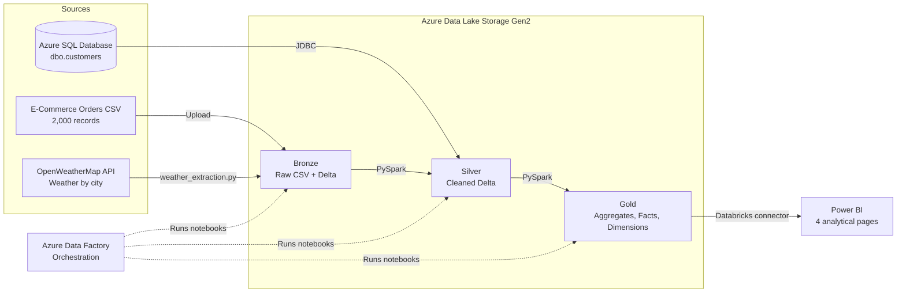

# Customer360 Retail Analytics

### Azure Data Factory · Databricks · PySpark · Delta Lake · Power BI · OpenWeatherMap API


A customer-centric retail analytics platform that unifies e-commerce order data, customer records, and **weather data** in a governed Azure lakehouse, then serves curated business metrics through Power BI.

| Area | Detail |
|---|---|
| **Source data** | 2,000 orders · 23 attributes · Azure SQL customer records · OpenWeatherMap weather API |
| **Processing** | 4 PySpark notebooks · Bronze → Silver → Gold |
| **Serving layer** | 10 Gold aggregates · 2 fact tables · 6 dimensions |
| **Analytics** | 4-page Power BI dashboard connected to Databricks |
| **Data sources** | 3 (CSV orders, Azure SQL customers, weather API) |

---

## Contents

1. [Overview](#1-overview)
2. [Problem Statement](#2-problem-statement)
3. [Architecture](#3-architecture)
4. [Tech Stack](#4-tech-stack)
5. [Repository Structure](#5-repository-structure)
6. [Data Sources](#6-data-sources)
7. [Pipeline Layers](#7-pipeline-layers)
8. [Transformations and Data Quality](#8-transformations-and-data-quality)
9. [Power BI Dashboard](#9-power-bi-dashboard)
10. [Pipeline Orchestration](#10-pipeline-orchestration)
11. [Getting Started](#11-getting-started)
12. [Security Notes](#12-security-notes)
13. [Project Report](#13-project-report)
14. [Author](#14-author)

---

## 1. Overview

The platform integrates three independent data sources:

- A 2,000-record e-commerce order CSV.
- A customer master table hosted in Azure SQL Database.
- **Weather data by city from the OpenWeatherMap API** (third data source).

Azure Data Factory orchestrates the workload. Databricks and PySpark handle ingestion, cleansing, joining, enrichment, and aggregation. All curated data is persisted as Delta Lake tables registered in Unity Catalog, giving Power BI a reliable and governed serving layer.

The result is a governed Customer 360 analytical model covering revenue, customer value, product performance, payment behaviour, device usage, returns, **and weather-influenced sales**.

---

## 2. Problem Statement

E-commerce data is typically scattered across order exports, customer databases, payment logs, and external services. Each source has its own identifiers, formats, and refresh cadence, which makes cross-source reporting slow and error-prone.

This project solves that problem by:

- Landing raw order data in a Bronze layer without altering the source.
- Reading the customer master directly from Azure SQL Database over JDBC.
- **Extracting weather data via a public API and staging it in Bronze.**
- Standardizing and enriching all three sources in a Silver layer.
- Publishing reusable business aggregates, facts, and dimensions in a Gold layer.
- Delivering a governed Customer 360 model for self-service analysis in Power BI.

---

## 3. Architecture



The pipeline follows the medallion pattern:

| Layer | Storage | Format | Responsibility |
|---|---|---|---|
| **Bronze** | `bronze` container | CSV + Delta | Raw ingestion of orders + weather; derived FullName |
| **Silver** | `silver` container | Delta | Cleansing, multi-source join (orders + customers + weather), enrichment, date decomposition, validation |
| **Gold** | `gold` container | Delta | Business aggregates, fact tables, dimension tables |
| **Serving** | Unity Catalog | Delta | Governed tables consumed by Power BI |

---

## 4. Tech Stack

| Domain | Technology |
|---|---|
| Cloud platform | Microsoft Azure |
| Orchestration | Azure Data Factory |
| Storage | Azure Data Lake Storage Gen2 (`abfss://`) |
| Relational source | Azure SQL Database |
| Third source API | OpenWeatherMap (weather by city) |
| Compute | Azure Databricks |
| Processing | PySpark, Spark SQL |
| Table format | Delta Lake |
| Governance and catalog | Unity Catalog (`ecommerce_catalog`) |
| Visualization | Power BI Desktop |
| Secrets management | Databricks Secrets, Azure Key Vault |
| Data extraction | Python (`requests`, `pandas`) |

---

## 5. Repository Structure

```text
customer360-retail-analytics/
│
├── Ecommerce_Workspace/
│   ├── Bronze_Ecommerce.py       # Raw CSV ingestion (Bronze)
│   ├── Silver_Ecommerce.py       # Cleansing, joining, enrichment (Silver)
│   ├── Gold_Ecommerce.py         # Business-level aggregations (Gold)
│   └── Fact_Tables.py            # Fact and dimension tables (Gold)
│
├── data_extraction.py            # Orders dataset download script (Layer 1)
├── weather_extraction.py         # Weather API extraction script (Layer 1, third source)
├── Ecommerce_2000.csv            # Source dataset — 2,000 order records
├── customer360-retail-analytics Dashboards.pbix
│                                 # Power BI dashboard
├── PROJECT_REPORT.md             # Full project report
├── README.md
├── .gitignore
└── manifest.mf                   # Databricks workspace manifest
```

---

## 6. Data Sources

### 6.1 E-Commerce Orders CSV

| Attribute | Details |
|---|---|
| File | `Ecommerce_2000.csv` |
| Records | 2,000 orders |
| Columns | 23 |
| Format | CSV with header |
| Landing zone | ADLS Gen2 Bronze container |

**Key columns:** `OrderID`, `CustomerID`, `FirstName`, `LastName`, `State`, `City`, `OrderDate`, `OrderSeason`, `OrderDayOfWeek`, `ProductCategory`, `ProductSubCategory`, `UnitPrice`, `Quantity`, `TotalAmount`, `DiscountPercent`, `DiscountAmount`, `FinalAmount`, `PaymentMethod`, `DeviceType`, `MembershipTier`, `ShippingDays`, `Returned`, `ReviewScore`.

### 6.2 Azure SQL Database — Customers

| Attribute | Details |
|---|---|
| Table | `dbo.customers` |
| Access | JDBC from Databricks |
| Join key | `CustomerID` |

Expected schema:
```sql
CREATE TABLE dbo.customers (
    customer_id   VARCHAR(10),
    customer_name VARCHAR(100),
    city          VARCHAR(50)
);
```

### 6.3 OpenWeatherMap API (Third Data Source)

| Attribute | Details |
|---|---|
| Source | `https://api.openweathermap.org/data/2.5/weather` |
| Access | REST API via `weather_extraction.py` |
| Join key | `City` |
| Authentication | `OPENWEATHER_API_KEY` environment variable |

**Weather attributes:** `Weather_Temp_C`, `Weather_Humidity`, `Weather_Condition`, `Weather_Wind_Speed`.

---

## 7. Pipeline Layers

### 7.1 Bronze Layer — Raw Ingestion

**Notebook:** `Ecommerce_Workspace/Bronze_Ecommerce.py`

- Reads `Ecommerce_2000.csv` (schema as strings).
- Derives `FullName = FirstName + " " + LastName`.
- Writes raw data as **Delta** to Bronze (`abfss://bronze@.../ecommerce/ecommerce_data`).
- Weather CSV (from `weather_extraction.py`) is also staged in Bronze under `ecommerce/weather_data`.

### 7.2 Silver Layer — Cleaned and Enriched

**Notebook:** `Ecommerce_Workspace/Silver_Ecommerce.py`

| Stage | Detail |
|---|---|
| Input | Bronze CSV + `dbo.customers` (JDBC) + weather CSV |
| Join | Orders ⋈ Customers on `CustomerID` ⋈ Weather on `City` |
| Processing | Removes duplicate columns, adds flags and date attributes |
| Output | `abfss://silver@.../ecommerce_orders` |
| Catalog table | `ecommerce_catalog.silver.orders_silver` |
| Format | Delta, overwrite mode |

**Enrichments:**
- `IsDiscounted` — Yes/No based on `DiscountPercent > 0`
- `Weekend` / `Weekday` — based on `OrderDayOfWeek`
- `Value_Orders` — High / Medium / Low based on `TotalAmount`
- `Order_Year`, `Order_Month`, `Order_Quarter` — date decomposition
- Weather columns — `Weather_Condition`, `Weather_Temp_C`, `Weather_Humidity`, `Weather_Wind_Speed`

**Validation:** prints row counts, matched/unmatched customers, null OrderID, invalid Quantity, negative FinalAmount, missing weather records.

### 7.3 Gold Layer — Business Aggregations

**Notebook:** `Ecommerce_Workspace/Gold_Ecommerce.py`

| Table | Grain | Key measures |
|---|---|---|
| `gold_orders` | Customer and city | `Total_Orders` |
| `gold_tier` | Membership tier | `Total_Customers` |
| `gold_revenue` | City | `Total_Revenue` |
| `gold_returns` | Return status | `Total_Orders` |
| `gold_customer_segments` | Customer | `Lifetime_Value`, `Total_Orders`, `Customer_Segment` |
| `gold_season_category` | Season and product category | `Total_Orders`, `Total_Revenue` |
| `gold_product_category` | Product category | `Total_Orders`, `Total_Revenue` |
| `gold_payment_method` | Payment method | `Total_Orders`, `Total_Revenue`, `Avg_Order_Value` |
| `gold_device_type` | Device type | `Total_Orders`, `Total_Revenue`, `Avg_Order_Value` |
| **`gold_weather_sales`** | **Weather condition** | **`Total_Orders`, `Total_Revenue`, `Avg_Order_Value`, `Avg_Temperature_C`** |

### 7.4 Fact and Dimension Tables

**Notebook:** `Ecommerce_Workspace/Fact_Tables.py`

**Fact tables**

| Table | Description |
|---|---|
| `fact_data` | Order-level descriptive attributes incl. weather context |
| `fact_numerical` | Order-level measures: quantity, pricing, discounts, shipping days, review score, date parts |

**Dimension tables**

| Table | Description | Key |
|---|---|---|
| `dim_customer` | Customer identity, location, membership tier | `customer_key` |
| `dim_product` | Distinct product category × sub-category | `product_key` |
| `dim_date` | Distinct order dates with year, month, quarter, season, weekend | `date_key` |
| `dim_payment` | Distinct payment methods | `payment_key` |
| `dim_device` | Distinct device types | `device_key` |
| **`dim_weather`** | **Distinct weather conditions with temp, humidity, wind** | **`weather_key`** |

---

## 8. Transformations and Data Quality

| Transformation | Layer | Logic |
|---|---|---|
| Full-name derivation | Bronze | `FirstName + " " + LastName` |
| Multi-source join | Silver | Orders ⋈ Customers (`CustomerID`) ⋈ Weather (`City`) |
| Duplicate-column removal | Silver | Drops duplicate customer `city` |
| Discount flag | Silver | `IsDiscounted = Yes` when `DiscountPercent > 0` |
| Weekend flag | Silver | `Weekend` if Saturday/Sunday, else `Weekday` |
| Order value band | Silver | High (>1,000), Medium (500–1,000), Low (≤500) |
| Date decomposition | Silver | `Order_Year`, `Order_Month`, `Order_Quarter` |
| Customer segmentation | Gold | LTV: Platinum ≥10,000 / Gold ≥5,000 / Silver ≥1,000 / Bronze |
| Weather enrichment | Silver | Join OpenWeatherMap data on `City` |
| Dimensional modelling | Gold | 2 fact tables + 6 dimensions with deterministic surrogate keys |

Validation is performed in Silver with row-count and data-quality checks emitted at runtime.

---

## 9. Power BI Dashboard

**File:** `customer360-retail-analytics Dashboards.pbix`

The dashboard connects directly to Databricks and exposes four analytical pages:

| Page | Focus | Key visuals |
|---|---|---|
| **Overview** | Executive summary | Total revenue, total orders, average lifetime value, average order value |
| **Sales Analysis** | Revenue drivers | Revenue by city, payment method, season, day of week |
| **Customer Intelligence** | Customer value | Segments, membership tier, device type, lifetime value by tier |
| **Products and Returns** | Product performance | Revenue and returns by category, seasonal trends, quarterly orders |

Weather-based insights (from `gold_weather_sales`) can be added to Sales Analysis or a new page to show revenue by weather condition.

### Opening the dashboard

1. Open the `.pbix` in Power BI Desktop.
2. Update the Databricks connection with server hostname, HTTP path, and access token.
3. Start the Databricks cluster.
4. Refresh the dataset.

---

## 10. Pipeline Orchestration

Azure Data Factory is the orchestrator. The ADF pipeline runs the notebooks in sequence:

| Activity | Type | Purpose |
|---|---|---|
| `Bronze_Ecommerce` | Databricks Notebook | Ingests order CSV |
| `Silver_Ecommerce` | Databricks Notebook | Cleans, joins (customers + weather), enriches |
| `Gold_Ecommerce` | Databricks Notebook | Builds Gold aggregates incl. weather sales |
| `Fact_Tables` | Databricks Notebook | Builds fact and dimension model incl. `dim_weather` |
| `Alert_Pipeline_Failure` | Web Activity | Sends failure notification |

**Trigger:** Daily schedule at 08:00 IST. Disabled in development to control Azure costs.

---

## 11. Getting Started

### Prerequisites

- Azure subscription with Azure Data Factory, ADLS Gen2, Azure SQL Database.
- Databricks workspace with PySpark + Delta Lake + SQL JDBC driver.
- Unity Catalog enabled with `ecommerce_catalog` catalog.
- Power BI Desktop.
- (Optional) OpenWeatherMap API key for weather enrichment.

### Configuration reference

| Setting | Location | Value |
|---|---|---|
| Storage account | Notebook widgets `storage_account` | Replace `stdataproject` with your account |
| SQL server | `sql_server` widget | `<sql-server>` |
| SQL database | `sql_database` widget | `<database>` |
| SQL credentials | Secret scope `azure-sql` | Keys `username` and `password` |
| Unity Catalog | Notebook SQL | `ecommerce_catalog` |
| Databricks connection | Power BI Desktop | Hostname, HTTP path, access token |
| OpenWeatherMap API key | Environment variable | `OPENWEATHER_API_KEY` |

### Step 1 — Provision Azure resources

Create storage account, SQL server/database, Data Factory, Databricks workspace. Organize ADLS Gen2 into `bronze`, `silver`, `gold` containers.

### Step 2 — Stage the source data

1. Upload `Ecommerce_2000.csv` to Bronze container under `ecommerce/`.
2. Create `dbo.customers` in Azure SQL Database using the schema in [Section 6](#62-azure-sql-database--customers).
3. Load customer records.

### Step 3 — Extract weather data (third source)

```bash
export OPENWEATHER_API_KEY=<your-key>
python weather_extraction.py
```
Upload the generated `weather_data.csv` to Bronze under `ecommerce/weather_data`.

### Step 4 — Configure Azure Data Factory

Create linked services for ADLS Gen2, Azure SQL Database, Azure Databricks. Add notebook activities in the order shown in [Section 10](#10-pipeline-orchestration).

### Step 5 — Import and configure the notebooks

1. Import the four notebooks from `Ecommerce_Workspace/` into Databricks.
2. Replace the storage account name in each notebook path (or use widgets).
3. Set `sql_server` and `sql_database` widget values in the Silver notebook.
4. Create the `azure-sql` secret scope and store SQL username/password.
5. Confirm `ecommerce_catalog`, `silver`, and `gold` schemas exist.

### Step 6 — Run the pipeline

```text
Bronze_Ecommerce.py
        ↓
Silver_Ecommerce.py
        ↓
Gold_Ecommerce.py
        ↓
Fact_Tables.py
```

### Step 7 — Connect Power BI

1. Open the `.pbix` in Power BI Desktop.
2. Update Databricks connection details.
3. Refresh the dataset.

---

## 12. Security Notes

- Store credentials in Databricks Secrets or Azure Key Vault; Silver reads SQL credentials from the `azure-sql` secret scope.
- OpenWeatherMap API key passed via `OPENWEATHER_API_KEY` environment variable; never hardcoded.
- Never commit credentials, connection strings, or access tokens to the repository.
- Restrict ADLS access with Unity Catalog external locations and least-privilege database accounts.

---

## 13. Project Report

See [`PROJECT_REPORT.md`](PROJECT_REPORT.md) for the full report including problem statement, architecture, data sources, pipeline layers, transformations, dashboard description, tech stack, and getting-started instructions.

---

## 14. Author

Piyush — `piyush080306-pixel`
