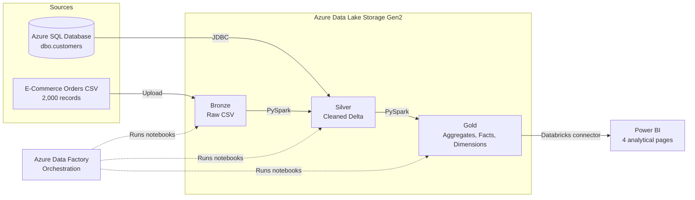

# Customer360 Retail Analytics

### Azure Data Factory · Databricks · PySpark · Delta Lake · Power BI


A customer-centric retail analytics platform that unifies e-commerce order data with customer records in a governed Azure lakehouse, then serves curated business metrics through Power BI.

| Area | Detail |
|---|---|
| **Source data** | 2,000 orders · 23 attributes · Azure SQL customer records |
| **Processing** | 4 PySpark notebooks · Bronze → Silver → Gold |
| **Serving layer** | 9 Gold aggregates · 2 fact tables · 5 dimensions |
| **Analytics** | 4-page Power BI dashboard connected to Databricks |

---

## Contents

1. [Overview](#1-overview)
2. [Problem Statement](#2-problem-statement)
3. [Architecture](#3-architecture)
4. [Tech Stack](#4-tech-stack)
5. [Repository Structure](#5-repository-structure)
6. [Data Sources](#6-data-sources)
7. [Pipeline Layers](#7-pipeline-layers)
8. [Transformations and Data Quality](#8-transformations-and-data-quality)
9. [Power BI Dashboard](#9-power-bi-dashboard)
10. [Pipeline Orchestration](#10-pipeline-orchestration)
11. [Getting Started](#11-getting-started)
12. [Security Notes](#12-security-notes)
13. [Author](#13-author)

---

## 1. Overview

The platform integrates two independent data sources:

- A 2,000-record e-commerce order CSV.
- A customer master table hosted in Azure SQL Database.

Azure Data Factory orchestrates the workload. Databricks and PySpark handle ingestion, cleansing, joining, enrichment, and aggregation. All curated data is persisted as Delta Lake tables registered in Unity Catalog, giving Power BI a reliable and governed serving layer.

The result is a governed Customer 360 analytical model covering revenue, customer value, product performance, payment behaviour, device usage, and returns.

---

## 2. Problem Statement

E-commerce data is typically scattered across order exports, customer databases, payment logs, and fulfilment systems. Each source has its own identifiers, formats, and refresh cadence, which makes cross-source reporting slow and error-prone.

This project solves that problem by:

- Landing raw order data in a Bronze layer without altering the source.
- Reading the customer master directly from Azure SQL Database over JDBC.
- Standardizing and enriching both sources in a Silver layer.
- Publishing reusable business aggregates, facts, and dimensions in a Gold layer.
- Delivering a governed Customer 360 model for self-service analysis in Power BI.

---

## 3. Architecture



The pipeline follows the medallion pattern:

| Layer | Storage | Format | Responsibility |
|---|---|---|---|
| **Bronze** | `bronze` container | CSV | Raw ingestion and a derived full-name field |
| **Silver** | `silver` container | Delta | Cleansing, multi-source join, enrichment, date decomposition |
| **Gold** | `gold` container | Delta | Business aggregates, fact tables, and dimensions |
| **Serving** | Unity Catalog | Delta | Governed tables consumed by Power BI |

---

## 4. Tech Stack

| Domain | Technology |
|---|---|
| Cloud platform | Microsoft Azure |
| Orchestration | Azure Data Factory |
| Storage | Azure Data Lake Storage Gen2 (`abfss://`) |
| Relational source | Azure SQL Database |
| Compute | Azure Databricks |
| Processing | PySpark, Spark SQL |
| Table format | Delta Lake |
| Governance and catalog | Unity Catalog (`ecommerce_catalog`) |
| Visualization | Power BI Desktop |
| Secrets management | Databricks Secrets, Azure Key Vault |

---

## 5. Repository Structure

```text
customer360-retail-analytics/
│
├── Ecommerce_Workspace/
│   ├── Bronze_Ecommerce.py       # Raw CSV ingestion
│   ├── Silver_Ecommerce.py       # Cleansing, joining, and enrichment
│   ├── Gold_Ecommerce.py         # Business-level aggregations
│   └── Fact_Tables.py            # Fact and dimension tables
│
├── Ecommerce_2000.csv            # Source dataset — 2,000 order records
├── customer360-retail-analytics Dashboards.pbix
│                                 # Power BI dashboard
├── manifest.mf                   # Databricks workspace manifest
├── .gitignore
└── README.md
```

---

## 6. Data Sources

### 6.1 E-Commerce Orders CSV

| Attribute | Details |
|---|---|
| File | `Ecommerce_2000.csv` |
| Records | 2,000 orders |
| Columns | 23 |
| Format | CSV with header |
| Landing zone | ADLS Gen2 Bronze container |
| Read mode | Strings in Bronze; schema inferred in Silver |

**Data dictionary**

| Column | Description |
|---|---|
| `OrderID` | Unique order identifier |
| `CustomerID` | Customer identifier |
| `FirstName`, `LastName` | Customer name fields |
| `State`, `City` | Customer location |
| `OrderDate` | Order date |
| `OrderSeason` | Season associated with the order |
| `OrderDayOfWeek` | Day of week the order was placed |
| `ProductCategory`, `ProductSubCategory` | Product hierarchy |
| `UnitPrice` | Price per unit |
| `Quantity` | Units ordered |
| `TotalAmount` | Order amount before discount |
| `DiscountPercent` | Discount percentage applied |
| `DiscountAmount` | Absolute discount value |
| `FinalAmount` | Final order value after discount |
| `PaymentMethod` | Payment instrument used |
| `DeviceType` | Device used to place the order |
| `MembershipTier` | Customer membership level |
| `ShippingDays` | Fulfilment duration in days |
| `Returned` | Return status |
| `ReviewScore` | Customer review rating |

### 6.2 Azure SQL Database — Customers

| Attribute | Details |
|---|---|
| Table | `dbo.customers` |
| Access | JDBC from Databricks |
| Join keys | `CustomerID`, `FullName`, `City` |

Expected schema:

```sql
CREATE TABLE dbo.customers (
    customer_id   VARCHAR(10),
    customer_name VARCHAR(100),
    city          VARCHAR(50)
);
```

The Bronze notebook derives `FullName` from `FirstName` and `LastName` so that orders can be matched to the customer master on a consistent key.

---

## 7. Pipeline Layers

### 7.1 Bronze Layer — Raw Ingestion

**Notebook:** `Ecommerce_Workspace/Bronze_Ecommerce.py`

| Stage | Detail |
|---|---|
| Input | `Ecommerce_2000.csv` in the Bronze container |
| Processing | Reads the CSV with headers, derives `FullName`, writes a raw copy |
| Output | `abfss://bronze@<storage-account>.dfs.core.windows.net/ecommerce/ecommerce_data` |
| Format | CSV, overwrite mode |

The Bronze layer preserves every source column and adds only the derived `FullName` field. Type inference, cleansing, and business rules are applied in Silver.

### 7.2 Silver Layer — Cleaned and Enriched

**Notebook:** `Ecommerce_Workspace/Silver_Ecommerce.py`

| Stage | Detail |
|---|---|
| Input | Bronze CSV and `dbo.customers` via JDBC |
| Join | Left join on `CustomerID`, `FullName`, and `City` |
| Processing | Removes duplicate customer columns, adds flags and date attributes |
| Output | `abfss://silver@<storage-account>.dfs.core.windows.net/ecommerce_orders` |
| Catalog table | `ecommerce_catalog.silver.orders_silver` |
| Format | Delta, overwrite mode |

The notebook also prints the total Silver row count and the number of orders matched to a customer record, providing a quick runtime sanity check.

### 7.3 Gold Layer — Business Aggregations

**Notebook:** `Ecommerce_Workspace/Gold_Ecommerce.py`

The Gold notebook reads the Silver Delta table and produces nine reporting aggregates. Each table is written to the Gold container and registered in Unity Catalog.

| Table | Grain | Key measures |
|---|---|---|
| `gold_orders` | Customer and city | `Total_Orders` |
| `gold_tier` | Membership tier | `Total_Customers` |
| `gold_revenue` | City | `Total_Revenue` |
| `gold_returns` | Return status | `Total_Orders` |
| `gold_customer_segments` | Customer | `Lifetime_Value`, `Total_Orders`, `Customer_Segment` |
| `gold_season_category` | Season and product category | `Total_Orders`, `Total_Revenue` |
| `gold_product_category` | Product category | `Total_Orders`, `Total_Revenue` |
| `gold_payment_method` | Payment method | `Total_Orders`, `Total_Revenue`, `Avg_Order_Value` |
| `gold_device_type` | Device type | `Total_Orders`, `Total_Revenue`, `Avg_Order_Value` |

### 7.4 Fact and Dimension Tables

**Notebook:** `Ecommerce_Workspace/Fact_Tables.py`

The dimensional model reuses the Silver layer and is registered under `ecommerce_catalog.gold`.

**Fact tables**

| Table | Description |
|---|---|
| `fact_data` | Order-level descriptive attributes, including customer, product, channel, and date context |
| `fact_numerical` | Order-level measures: quantity, pricing, discounts, shipping days, review score, and date parts |

**Dimension tables**

| Table | Description | Key |
|---|---|---|
| `dim_customer` | Customer identity, location, and membership tier | `customer_key` |
| `dim_product` | Distinct product category and sub-category combinations | `product_key` |
| `dim_date` | Distinct order dates with year, month, quarter, season, and weekend flag | `date` |
| `dim_payment` | Distinct payment methods | `payment_key` |
| `dim_device` | Distinct device types | `device_key` |

---

## 8. Transformations and Data Quality

### Implemented transformations

| Transformation | Layer | Logic |
|---|---|---|
| Full-name derivation | Bronze | Concatenates `FirstName` and `LastName` into `FullName` |
| Multi-source join | Silver | Left joins orders to `dbo.customers` on customer ID, full name, and city |
| Duplicate-column removal | Silver | Drops the duplicate customer city and join-only fields |
| Discount flag | Silver | `IsDiscounted = Yes` when `DiscountPercent > 0`, otherwise `No` |
| Weekend flag | Silver | `Weekend` when the order day is Saturday or Sunday, otherwise `Weekday` |
| Order value band | Silver | `High` when `TotalAmount > 1,000`; `Medium` when `500 < TotalAmount < 1,000`; otherwise `Low` |
| Date decomposition | Silver | Derives `Order_Year`, `Order_Month`, and `Order_Quarter` from `OrderDate` |
| Customer segmentation | Gold | Segments lifetime value into Platinum (≥ 10,000), Gold (≥ 5,000), Silver (≥ 1,000), and Bronze |
| Business aggregation | Gold | Revenue, order counts, averages, tier distribution, and return analysis |
| Dimensional modelling | Gold | Builds two fact tables and five dimension tables |

Validation is currently limited to the row-count and join-coverage checks emitted by the Silver notebook.

---

## 9. Power BI Dashboard

**File:** `customer360-retail-analytics Dashboards.pbix`

The dashboard connects directly to Databricks and exposes four analytical pages:

| Page | Focus | Key visuals |
|---|---|---|
| **Overview** | Executive summary | Total revenue, total orders, average lifetime value, average order value |
| **Sales Analysis** | Revenue drivers | Revenue by city, payment method, season, and day of week |
| **Customer Intelligence** | Customer value | Segments, membership tier, device type, lifetime value by tier |
| **Products and Returns** | Product performance | Revenue and returns by category, seasonal trends, quarterly orders |

### Opening the dashboard

1. Open `customer360-retail-analytics Dashboards.pbix` in Power BI Desktop.
2. Update the Databricks connection with the server hostname, HTTP path, and access token.
3. Start the Databricks cluster.
4. Refresh the dataset.

---

## 10. Pipeline Orchestration

Azure Data Factory is the orchestrator. The ADF pipeline is configured in Azure, while this repository contains the notebooks and assets it executes.

| Activity | Type | Purpose |
|---|---|---|
| `Bronze_Ecommerce` | Databricks Notebook | Ingests the order CSV |
| `Silver_Ecommerce` | Databricks Notebook | Cleans, joins, and enriches the data |
| `Gold_Ecommerce` | Databricks Notebook | Builds the nine Gold aggregates |
| `Fact_Tables` | Databricks Notebook | Builds the fact and dimension model |
| `Alert_Pipeline_Failure` | Web Activity | Sends a failure notification |

**Linked services:** Azure Databricks, Azure Data Lake Storage Gen2, Azure SQL Database.

**Trigger:** Daily schedule at 08:00 IST. The trigger is disabled in development to control Azure costs.

The Silver notebook reads the customer master directly from Azure SQL over JDBC. A Copy Data activity can optionally archive source extracts to Bronze, but it is not required for the transformation path.

---

## 11. Getting Started

### Prerequisites

- An Azure subscription with Azure Data Factory, ADLS Gen2, and Azure SQL Database.
- A Databricks workspace with a cluster that supports PySpark and Delta Lake.
- Unity Catalog enabled with an `ecommerce_catalog` catalog.
- Power BI Desktop.
- The Databricks SQL Server JDBC driver available on the cluster.

### Configuration reference

| Setting | Location | Value |
|---|---|---|
| Storage account | Notebook paths | Replace `stdataproject` with your account |
| SQL server | `sql_server` widget | `<sql-server>` |
| SQL database | `sql_database` widget | `<database>` |
| SQL credentials | Secret scope `azure-sql` | Keys `username` and `password` |
| Unity Catalog | Notebook SQL | `ecommerce_catalog` |
| Databricks connection | Power BI Desktop | Hostname, HTTP path, access token |

### Step 1 — Provision Azure resources

Create the storage account, SQL server, SQL database, Data Factory, and Databricks workspace. Organize ADLS Gen2 into `bronze`, `silver`, and `gold` containers.

### Step 2 — Stage the source data

1. Upload `Ecommerce_2000.csv` to the Bronze container under `ecommerce/`.
2. Create `dbo.customers` in Azure SQL Database using the schema in [Section 6](#62-azure-sql-database--customers).
3. Load the customer records.

### Step 3 — Configure Azure Data Factory

Create linked services for ADLS Gen2, Azure SQL Database, and Azure Databricks. Add the notebook activities in the order shown in [Section 10](#10-pipeline-orchestration).

### Step 4 — Import and configure the notebooks

1. Import the four notebooks from `Ecommerce_Workspace/` into Databricks.
2. Replace the storage account name in each notebook path.
3. Set the `sql_server` and `sql_database` widget values in the Silver notebook.
4. Create the `azure-sql` secret scope and store the SQL username and password.
5. Confirm that `ecommerce_catalog`, the `silver` schema, and the `gold` schema exist.

### Step 5 — Run the pipeline in order

```text
Bronze_Ecommerce.py
        ↓
Silver_Ecommerce.py
        ↓
Gold_Ecommerce.py
        ↓
Fact_Tables.py
```

Alternatively, run the ADF pipeline to execute the same sequence with orchestration and failure handling.

### Step 6 — Connect Power BI

1. Open `customer360-retail-analytics Dashboards.pbix`.
2. Update the Databricks connection details.
3. Refresh the dataset.

---

## 12. Security Notes

- Store credentials in Databricks Secrets or Azure Key Vault; the Silver notebook reads SQL credentials from the `azure-sql` secret scope.
- Never commit credentials, connection strings, or access tokens to the repository.
- Restrict ADLS access with Unity Catalog external locations and use least-privilege database accounts.

---
